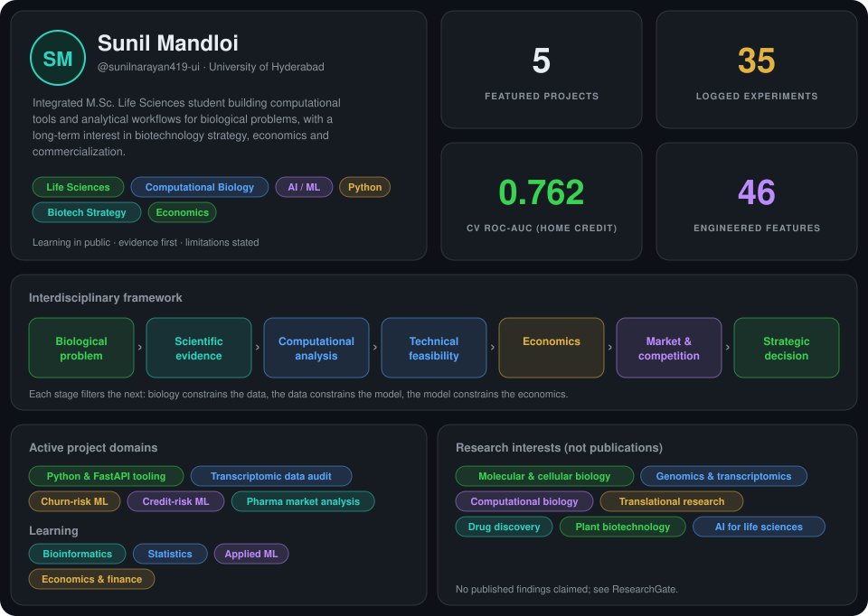
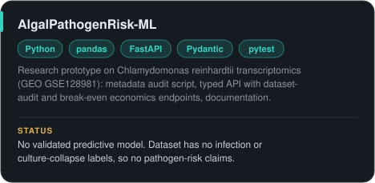
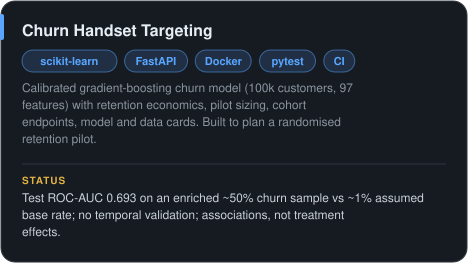
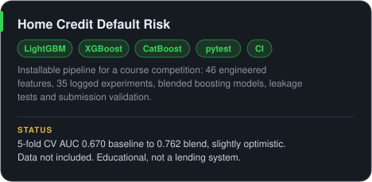
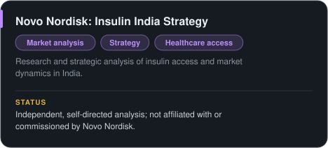
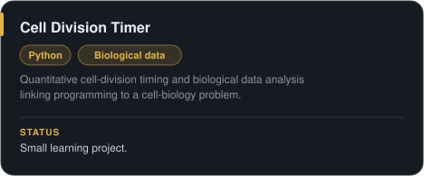
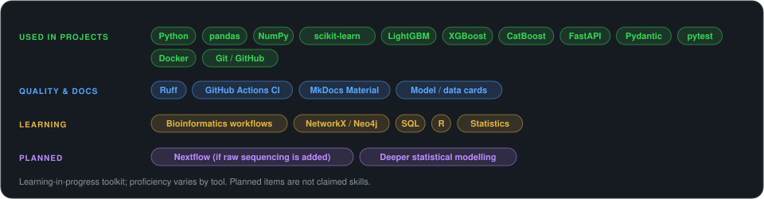
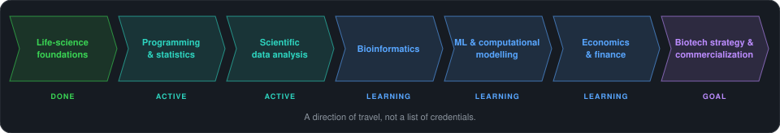

> **How does a biological discovery become a technically feasible, economically viable, and strategically valuable business decision?** I use projects to practise that chain end to end: inspect the data, make assumptions explicit, build and test something, then state what the evidence does and does not support.

## 🚀 Featured projects

<table>
<tr>
<td width="50%" valign="top"></td>
<td width="50%" valign="top"></td>
</tr>
<tr>
<td width="50%" valign="top"></td>
<td width="50%" valign="top"></td>
</tr>
<tr>
<td width="50%" valign="top"></td>
<td width="50%" valign="top">

**More work** 
[Mini Bio-Python Projects](https://github.com/sunilnarayan419-ui/Mini-Bio-Python-Projects) · [Library Management System](https://github.com/sunilnarayan419-ui/Library-Management-System)  
[Browse all repositories →](https://github.com/sunilnarayan419-ui?tab=repositories)

</td>
</tr>
</table>

## 🛠️ Tech stack

## 🔬 Research interests

Molecular and cellular biology, genomics and transcriptomics, computational biology, translational research, drug discovery, plant biotechnology and AI for life sciences. I have posted questions on [ResearchGate](https://www.researchgate.net/profile/Sunil-Mandloi-2) about horseshoe-crab innate immunity as inspiration for diagnostic design, and about transcriptional activity across accessible chromatin. These are **interests and discussion topics, not publications or experimental findings.**

## ⚙️ How I work

**Problem → Research → Analysis → Implementation → Validation → Decision**

Outputs are both **technical artifacts** (code, models, APIs, reproducible workflows) and **decision artifacts** (evidence summaries, economic analysis, recommendations), always with limitations and uncertainty stated.

## 🗺️ Learning roadmap

## 📊 GitHub activity

Third-party cards built from public data; they may be delayed or unavailable.

## 🤝 Collaboration

I am looking for research projects, internships and collaborations in computational biology, bioinformatics, scientific software, AI for life sciences and evidence-driven biotech strategy. Long term, I aim toward biotechnology business consulting; I do not currently offer client services.

**Science** explains what may be possible. **Data** shows what is happening.
**Economics** weighs value and constraints. **Strategy** decides what to do next.

Layout inspired by the bento template of <a href="https://github.com/whoisyurii/checkmygit">CheckMyGit</a> (MIT). No CheckMyGit code or assets are used.

